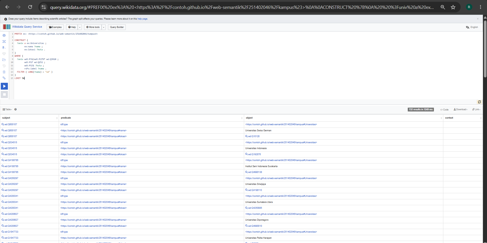

# Pertemuan 11 - CONSTRUCT dan Hierarki Data

## Langkah 1 - Solution menjadi triple

| Solution | ?d | ?mk | Triple yang dicetak |
|---|---|---|---|
| 1 | ex:budi | ex:tif2108 | ex:tif2108 a ex:MataKuliahAktif . ex:tif2108 ex:diampuOleh ex:budi . |
| 2 | ex:budi | ex:tif2104 | ex:tif2104 a ex:MataKuliahAktif . ex:tif2104 ex:diampuOleh ex:budi . |
| 3 | ex:sari | ex:tif2108 | ex:tif2108 a ex:MataKuliahAktif . ex:tif2108 ex:diampuOleh ex:sari . |
| 4 | ex:ida | ex:tif2104 | ex:tif2104 a ex:MataKuliahAktif . ex:tif2104 ex:diampuOleh ex:ida . |

- **Jumlah solution:** 4
- **Jumlah cetakan triple:** 8
- **Jumlah triple di graf hasil:** 6
- **Triple yang tercetak lebih dari sekali:** 
  - `ex:tif2108 a ex:MataKuliahAktif .` (dari Solution 1 dan Solution 3)
  - `ex:tif2104 a ex:MataKuliahAktif .` (dari Solution 2 dan Solution 4)

---

## Langkah 2 - Tebak lalu cek
| Soal | Tebakan | Hasil mesin | Penjelasan bila meleset |
|------|---------|-------------|-------------------------|
| A    |     3   | 3           | -                       |
| B    | 4       | 4           | -                       |
| C    | 3       | 3           | -                       |
| D    |  1      | 0           | Ternyata yang punya ex:tendik itu tidak punya ex:nama jadinya dia kosong karena gabisa buat RDF dengan perintah construct dan itu tidak eror karena Optional              |

## Langkah 3 - Graf kampus lokal
- Berkas sumber dan IRI dasar graf: `pertemuan-09/kampus_usu_v2.ttl` . IRI dasar: `https://f-comand02.github.io/web-semantik-kelompok06/251402004/kampus#`
- Kelas dosen dan properti nama: `ex:Lecturer` dan `foaf:name`
- Triple hasil pemetaan: 6 (3 dosen × 2 triple, yaitu `a schema:Person` dan `schema:name`)
- foaf:Person sebelum / sesudah: 0 / 3
- Triple asli vs triple turunan: Yang saya tulis sendiri adalah semua triple di `kampus_usu_v2.ttl` ditambah dua triple hierarki yang saya masukkan lewat `INSERT DATA`: `ex:Lecturer rdfs:subClassOf ex:Pegawai` dan `ex:Pegawai rdfs:subClassOf foaf:Person`. Yang hasil materialisasi adalah 6 triple `a ex:Pegawai` dan `a foaf:Person` untuk `ex:ida`, `ex:ivan`, dan `ex:umay`. Di dalam `kampus_usu_v4.ttl` keduanya tampil sama sebagai triple biasa (misalnya `ex:ida a foaf:Person, ex:Lecturer, ex:Pegawai`) dan tidak ada penanda asalnya. Satu-satunya cara membedakan adalah membandingkan dengan sumber: triple yang ada di v4 tetapi tidak ada di v2, di luar dua triple hierarki tadi, adalah hasil materialisasi.
- Dosen baru setelah program selesai: Dosen baru yang hanya ditulis `a ex:Lecturer` tidak otomatis mendapat `a ex:Pegawai` atau `a foaf:Person`, karena materialisasi hanya snapshot saat program dijalankan dan tidak memantau perubahan graf. Agar konsisten, program harus dijalankan ulang untuk menghasilkan v4 yang baru. Alternatifnya, pakai query dengan property path (`?x a/rdfs:subClassOf* foaf:Person`) yang menghitung hierarki setiap kali query dijalankan, sehingga dosen baru langsung ikut terhitung.

## Langkah 4 - Wikidata
- Jumlah triple Q6: 128
- Jumlah baris Q6 versi SELECT: 50
- Penjelasan perbedaan: Jumlah triple yang terbentuk (128) tidak sama dengan 3 × jumlah baris (150). Pertama, klausa `LIMIT 50` membatasi pola `WHERE` hingga 50 *solution*, yang masing-masing dicetak menjadi 3 pola triple. Kedua, beberapa universitas memiliki lebih dari satu nilai lokasi administratif (`wdt:P131`) atau lebih dari satu label berbahasa Indonesia (`rdfs:label`), sehingga di `SELECT` muncul sebagai baris terpisah, sedangkan pada `CONSTRUCT` triple yang identik (seperti `?univ a ex:Universitas`) otomatis dilebur menjadi satu karena graf RDF merupakan himpunan (*set*) tanpa duplikat.
- Q7 dengan + vs *: Operator `+` (`wdt:P279+`) menelusuri relasi *subclass of* secara transitif dengan panjang jalur minimal 1 langkah, sehingga hanya menampilkan kelas-kelas turunan di bawah `wd:Q3918`. Sebaliknya, operator `*` (`wdt:P279*`) menyertakan jalur dengan panjang 0 langkah, sehingga kelas induknya sendiri (`wd:Q3918` / universitas) ikut muncul dalam hasil query.
- Kelas yang mengejutkan dan alasannya: **Universitas korporat** (*corporate university*, `wd:Q1134696`) — Meski bukan perguruan tinggi akademik formal yang memberikan gelar layaknya universitas konvensional, di Wikidata entitas ini dimodelkan sebagai subkelas dari universitas (`wd:Q3918`) karena ontologi Wikidata mengelompokkan konsep berdasarkan kemiripan fungsi konseptual dan struktur kelembagaannya sebagai institusi pendidikan/pelatihan tingkat lanjut.

## Langkah 5 - Graf dari Python
- Jumlah triple universitas.ttl: 128
- Jumlah baris universitas_per_kota.csv: [isi jumlah baris data pada universitas_per_kota.csv, tidak termasuk header]
- setReturnFormat(TURTLE): Menginstruksikan `SPARQLWrapper` untuk meminta server endpoint Wikidata mengembalikan respons hasil query `CONSTRUCT` dalam format serialisasi RDF Turtle (bukan format tabel seperti JSON atau XML).
- Graph().parse(data=...): Mengurai (*parsing*) data mentah berformat Turtle yang diterima dari respons HTTP Wikidata menjadi struktur graf RDF di memori lokal milik `rdflib`, sehingga data tersebut dapat di-query kembali dan diserialisasi ke berkas lokal.
- Mengapa q_kota tidak memanggil endpoint: Karena objek graf `g` sudah menyimpan salinan lokal seluruh triple hasil unduhan dari Wikidata di memori (dan telah di-cache ke dalam berkas `universitas.ttl`), sehingga `g.query(q_kota)` dieksekusi sepenuhnya secara lokal oleh mesin SPARQL bawaan `rdflib` tanpa melakukan koneksi jaringan ke server Wikidata lagi.

## Refleksi
1. Mengapa jumlah triple hasil CONSTRUCT bisa lebih kecil dari jumlah baris SELECT dengan WHERE yang sama?
   Karena `SELECT` mengembalikan hasil dalam bentuk tabel multihimpunan (*bag*) yang mempertahankan setiap kombinasi baris dari *solution* walaupun beberapa kolomnya bernilai sama. Sebaliknya, `CONSTRUCT` menghasilkan sebuah graf RDF yang secara matematis merupakan himpunan (*set*), sehingga triple yang identik (subjek, predikat, dan objeknya sama persis) otomatis terdeduplikasi dan hanya disimpan satu kali. Selain itu, jika ada variabel pada template `CONSTRUCT` yang tidak terikat (*unbound*, misalnya akibat `OPTIONAL`), triple tersebut tidak dicetak ke dalam graf hasil.
2. Bila taksonomi di graf kampus Anda berubah bulan depan, apa yang terjadi pada triple turunan di kampus_usu_v4.ttl?
   Triple turunan yang sudah tersimpan di dalam `kampus_usu_v4.ttl` tidak akan berubah maupun terhapus secara otomatis karena file tersebut merupakan hasil materialisasi statis (*snapshot*) pada saat program dijalankan. Jika ada penambahan, perubahan, atau penghapusan aturan `rdfs:subClassOf` pada taksonomi bulan depan, berkas `kampus_usu_v4.ttl` menjadi usang (*stale*) dan script materialisasi harus dijalankan ulang dari sumber data yang telah diperbarui.
3. Kapan Anda menyimpan hasil query sebagai tabel (CSV), dan kapan sebagai graf (Turtle)?
   Hasil query disimpan sebagai **tabel (CSV)** ketika data sudah siap dikonsumsi untuk pelaporan akhir, agregasi statistik (`COUNT`, `SUM`, `GROUP BY`), visualisasi grafik, atau diolah di perangkat lunak tabular seperti Excel/pandas. Sebaliknya, hasil query disimpan sebagai **graf (Turtle)** ketika data tersebut masih mempertahankan relasi semantik, ingin digabungkan (*merge*) dengan dataset RDF lain, dijadikan *cache* lokal dari endpoint publik, atau akan di-query serta diinferensi kembali di tahap pemrosesan berikutnya.
