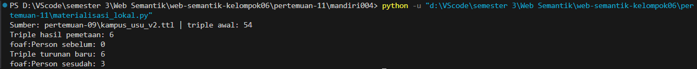

# Pertemuan 11 - CONSTRUCT dan Hierarki Data

## Langkah 1 - Solution menjadi triple

| Solution | ?d | ?mk | Triple yang dicetak |
|---|---|---|---|
| 1 | ex:budi | ex:tif2108 | ex:tif2108 a ex:MataKuliahAktif . ex:tif2108 ex:diampuOleh ex:budi . |
| 2 | ex:budi | ex:tif2104 | ex:tif2104 a ex:MataKuliahAktif . ex:tif2104 ex:diampuOleh ex:budi . |
| 3 | ex:sari | ex:tif2108 | ex:tif2108 a ex:MataKuliahAktif . ex:tif2108 ex:diampuOleh ex:sari . |
| 4 | ex:ida | ex:tif2104 | ex:tif2104 a ex:MataKuliahAktif . ex:tif2104 ex:diampuOleh ex:ida . |

- **Jumlah solution:** 4
- **Jumlah cetakan triple:** 8
- **Jumlah triple di graf hasil:** 6
- **Triple yang tercetak lebih dari sekali:** 
  - `ex:tif2108 a ex:MataKuliahAktif .` (dari Solution 1 dan Solution 3)
  - `ex:tif2104 a ex:MataKuliahAktif .` (dari Solution 2 dan Solution 4)

---

## Langkah 2 - Tebak lalu cek
| Soal | Tebakan | Hasil mesin | Penjelasan bila meleset |
|------|---------|-------------|-------------------------|
| A    | [isi]   | [isi]       | [isi]                   |
| B    | [isi]   | [isi]       | [isi]                   |
| C    | [isi]   | [isi]       | [isi]                   |
| D    | [isi]   | [isi]       | [isi]                   |

## Langkah 3 - Graf kampus lokal
- Berkas sumber dan IRI dasar graf: `pertemuan-09/kampus_usu_v2.ttl` . IRI dasar: `https://f-comand02.github.io/web-semantik-kelompok06/251402004/kampus#`
- Kelas dosen dan properti nama: `ex:Lecturer` dan `foaf:name`
- Triple hasil pemetaan: 6 (3 dosen × 2 triple, yaitu `a schema:Person` dan `schema:name`)
- foaf:Person sebelum / sesudah: 0 / 3
- Triple asli vs triple turunan: Yang saya tulis sendiri adalah semua triple di `kampus_usu_v2.ttl` ditambah dua triple hierarki yang saya masukkan lewat `INSERT DATA`: `ex:Lecturer rdfs:subClassOf ex:Pegawai` dan `ex:Pegawai rdfs:subClassOf foaf:Person`. Yang hasil materialisasi adalah 6 triple `a ex:Pegawai` dan `a foaf:Person` untuk `ex:ida`, `ex:ivan`, dan `ex:umay`. Di dalam `kampus_usu_v4.ttl` keduanya tampil sama sebagai triple biasa (misalnya `ex:ida a foaf:Person, ex:Lecturer, ex:Pegawai`) dan tidak ada penanda asalnya. Satu-satunya cara membedakan adalah membandingkan dengan sumber: triple yang ada di v4 tetapi tidak ada di v2, di luar dua triple hierarki tadi, adalah hasil materialisasi.
- Dosen baru setelah program selesai: Dosen baru yang hanya ditulis `a ex:Lecturer` tidak otomatis mendapat `a ex:Pegawai` atau `a foaf:Person`, karena materialisasi hanya snapshot saat program dijalankan dan tidak memantau perubahan graf. Agar konsisten, program harus dijalankan ulang untuk menghasilkan v4 yang baru. Alternatifnya, pakai query dengan property path (`?x a/rdfs:subClassOf* foaf:Person`) yang menghitung hierarki setiap kali query dijalankan, sehingga dosen baru langsung ikut terhitung.

## Langkah 4 - Wikidata
- Jumlah triple Q6: [isi]
- Jumlah baris Q6 versi SELECT: [isi]
- Penjelasan perbedaan: [isi]
- Q7 dengan + vs *: [isi]
- Kelas yang mengejutkan dan alasannya: [isi]

## Langkah 5 - Graf dari Python
- Jumlah triple universitas.ttl: [isi]
- Jumlah baris universitas_per_kota.csv: [isi]
- setReturnFormat(TURTLE): [isi]
- Graph().parse(data=...): [isi]
- Mengapa q_kota tidak memanggil endpoint: [isi]

## Refleksi
1. Mengapa jumlah triple hasil CONSTRUCT bisa lebih kecil dari jumlah baris SELECT dengan WHERE yang sama?
2. Bila taksonomi di graf kampus Anda berubah bulan depan, apa yang terjadi pada triple turunan di kampus_usu_v4.ttl?
3. Kapan Anda menyimpan hasil query sebagai tabel (CSV), dan kapan sebagai graf (Turtle)?